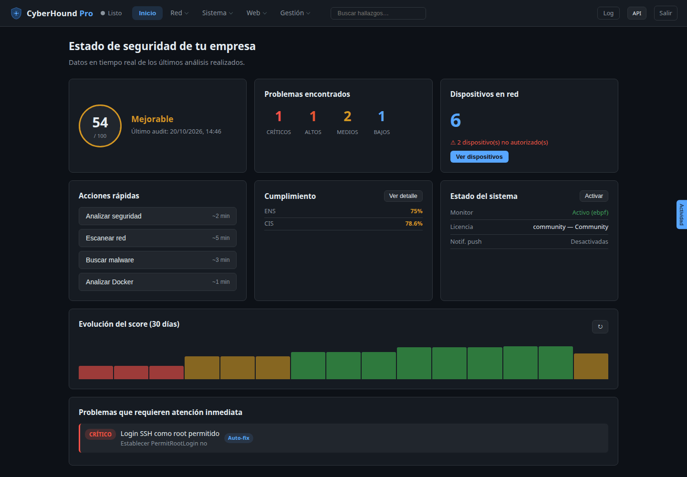
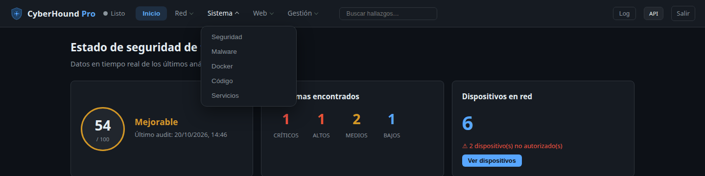

# CyberHound Pro — Manual de uso

Guía práctica para el día a día. Para instalar, ver el [README](../README.md#instalación) y los
[requisitos](../README.md#requisitos).



---

## 1. Acceder a la interfaz

| Instalación | Cómo arranca | Dónde está la configuración |
|---|---|---|
| Docker | `docker compose up -d` | `/data/config.yaml` (volumen) |
| `install.sh` | servicio `cyberhound` (systemd) | `/root/.cyberhound/config.yaml` |
| A mano | `cyberhound web --config <fichero>` | `~/.cyberhound/config.yaml` por defecto |

Abre **https://TU_HOST:8443** (certificado autofirmado la primera vez: el navegador avisará). Por
defecto solo escucha en `127.0.0.1`; para la red, `server.host: 0.0.0.0` en la configuración,
`--host 0.0.0.0` o `CH_HOST=0.0.0.0` en Docker.

Credenciales: las que fijaste con `cyberhound setup`, las que mostró `install.sh`, o la contraseña
que Docker generó en el primer arranque (`docker compose logs cyberhound | grep -i contraseña`).

> `cyberhound web --no-auth` (sin login) solo acepta conexiones desde `127.0.0.1`: para pruebas locales.

### Navegación

La interfaz se adapta a cualquier pantalla (escritorio, tablet, móvil, sin scroll lateral) y agrupa
las funciones en cinco menús:



| Menú | Funciones |
|---|---|
| **Inicio** | Panel de estado (score, problemas, dispositivos, cumplimiento, sistema) |
| **Red** | Mi Red · Subdominios · DNS Security · Intel |
| **Sistema** | Seguridad · Malware · Docker · Código · Servicios |
| **Web** | TLS/SSL · Cabeceras Web · Exposición Web · API / CORS · Nuclei |
| **Gestión** | Historial · Monitor · Informes · Configuración |

En móvil los menús se abren con **☰**. Arriba a la derecha: buscador de hallazgos, **Log**, **API**
(documentación Swagger), tu usuario y rol (y la organización, en multi-tenant) y **Salir**.

## 2. El panel (Inicio)

| Tarjeta | Qué muestra |
|---|---|
| **Score** | Puntuación 0-100 y grado del último análisis |
| **Problemas encontrados** | Recuento por severidad y comparación con el análisis anterior |
| **Dispositivos en red** | Activos conocidos y los no autorizados |
| **Acciones rápidas** | Analizar seguridad, red, malware, Docker |
| **Cumplimiento** | % de controles **CIS** y **ENS** cubiertos |
| **Estado del sistema** | Monitor en tiempo real y notificaciones del navegador |
| **Evolución del score** | Media diaria de los últimos 30 días |

### Cómo se interpreta el score
| Grado | Score | Significado |
|---|---|---|
| **A** | 90-100 | Excelente |
| **B** | 75-89 | Bueno |
| **C** | 60-74 | Mejorable |
| **D** | 40-59 | Deficiente |
| **F** | 0-39 | Crítico |

> Un sistema **recién instalado** suele puntuar ~60 ("Mejorable"): tiene hardening pendiente pero no
> riesgos activos. Los **críticos** hunden el score; el volumen de hallazgos leves, no.

## 3. Lanzar análisis

Cada función abre su panel: rellena el objetivo y pulsa **Analizar** (o usa las *Acciones rápidas*).
Los hallazgos aparecen en vivo con su severidad y evidencia; pulsa uno para ver el detalle.

| Menú | Función | Qué audita | Requiere |
|---|---|---|---|
| Sistema | **Seguridad** | Hardening del SO (31 checks) + score | root |
| Red | **Mi Red** | Descubrimiento, SO, CVEs y auditoría SSH de cada host | `nmap` (+root para el SO) |
| Sistema | **Malware** | YARA, hashes (VirusTotal/MalwareBazaar), auditd, cron, webshells | — |
| Sistema | **Docker** | 7 checks de Docker + 11 de Kubernetes, imágenes (Trivy) | Docker / `kubectl` |
| Sistema | **Código** | bandit, shellcheck, eslint y secretos en una ruta | esas herramientas |
| Sistema | **Servicios** | nginx, apache, MySQL, PostgreSQL, Redis, MongoDB | — |
| Web | **TLS/SSL** | Certificados y protocolos de tus HTTPS | — |
| Web | **Cabeceras Web** | CSP, HSTS y demás cabeceras de seguridad | — |
| Web | **Exposición Web** | `.git`/`.env`, copias, listados, métodos peligrosos | — |
| Web | **API / CORS** | CORS roto, documentación de API, GraphQL | — |
| Red | **DNS Security** | SPF/DMARC/DKIM/DNSSEC/CAA de un dominio | — |
| Red | **Subdominios** | Enumeración por Certificate Transparency | — |
| Red | **Intel** | IPs, dominios, hashes o emails en Shodan, VirusTotal, AbuseIPDB, GreyNoise, OTX, HIBP | API keys (Configuración › API Keys) |
| Web | **Nuclei** | Plantillas de ProjectDiscovery | binario `nuclei` + plantillas |

## 4. Corregir hallazgos

Los hallazgos con ⚡ tienen **corrección automática**: pulsa **Corregir** (en los de otro host,
**Corregir en &lt;host&gt;**, que se aplica por SSH en ese host). Revisa antes lo que va a hacer:
cambios de firewall, SSH o montajes **pueden afectar a servicios** en producción.

- Los fixes se pueden **deshacer**: el botón pasa a **↶ Deshacer**. En los locales las instalaciones
  de paquetes se marcan como no reversibles (no se desinstala nada a ciegas). En los remotos se guarda
  el estado anterior del host; **Configuración › Fixes remotos** lista los aplicados y permite
  deshacerlos más tarde (usa las credenciales SSH del panel Red).
- Activar el firewall abre antes SSH y el puerto de CyberHound, para no dejarte fuera.
- **Playbook de Ansible**: en **Informes** se descarga un playbook con las correcciones de los
  hallazgos (un play por host; lo que no se puede automatizar aparece comentado al principio).
  Revísalo y pruébalo con `ansible-playbook --check --diff` antes de aplicarlo; necesita las
  colecciones `ansible.posix` y `community.general` (vienen con el paquete `ansible`). Desde
  **Configuración › Ansible** se lanza en este mismo servidor, solo con sus propios hallazgos, o en AWX.
- Todo queda en el log de auditoría (`security_audit.log`).
- **Supresiones**: lo que sea un falso positivo se suprime con un patrón y un motivo
  (Configuración › Supresiones); deja de aparecer en los análisis siguientes.

## 5. Usuarios, roles y 2FA

En **Configuración › Usuarios** (solo admin) se crean usuarios con rol `viewer` (ver), `operator`
(ver, analizar y corregir) o `admin` (todo). La interfaz desactiva lo que tu rol no permite y el
servidor lo rechaza aunque se intente por la API.

En **Configuración › 2FA** cada usuario activa el doble factor: escanea el QR con una app TOTP,
guarda los **códigos de recuperación** (solo se muestran una vez) y confirma con un código. A partir
de ahí el login pide contraseña y código. Para desactivarlo también hay que dar un código.

En **Configuración › Mi cuenta** cada usuario cambia su contraseña (se cierran sus demás sesiones),
ve dónde tiene la sesión abierta y cierra las que no reconozca, y crea **tokens de API** para
scripts: `curl -H "Authorization: Bearer cht_…" https://<servidor>/api/history`. El token se muestra
una sola vez, nunca tiene más permisos que tu rol y no sirve para cambiar contraseñas, 2FA ni sesiones.

**Configuración › Auditoría** (solo admin) muestra quién hizo qué y desde qué IP: inicios de sesión
(también los fallidos), usuarios, contraseñas, 2FA, tokens, credenciales SSH, fixes remotos y
programaciones.

### Credenciales SSH guardadas

En **Configuración › Credenciales SSH** (crear y borrar, solo admin) se guardan las credenciales para
entrar por SSH en tus equipos sin escribirlas cada vez:

1. Ponle un nombre, el usuario y el puerto.
2. Elige el tipo. Lo recomendable es **Generar un par de claves**: CyberHound crea una clave ed25519 y
   te enseña la **clave pública**, que tienes que añadir a `~/.ssh/authorized_keys` de ese usuario en
   cada equipo (la privada no sale del servidor). También puedes **pegar una clave privada** (con su
   frase de paso si la tiene) o guardar una **contraseña**.
3. En el panel **Red**, elige la credencial en *Credencial SSH*: se usa para auditar, para corregir
   y para deshacer fixes remotos.

El secreto se guarda cifrado y no se vuelve a mostrar; la tabla enseña la huella y la clave pública.
Un operador puede usar las credenciales pero no verlas. No se puede borrar una credencial que use un
análisis programado.

## 6. Organizaciones (multi-tenant)

Con `multi_tenant.enabled: true`, el admin de la plataforma gestiona organizaciones en
**Configuración › Organizaciones** (alta con su primer administrador, nueva clave de agente, baja) y
puede verlas con el selector de la cabecera. Cada organización entra escribiendo su identificador en
el campo *Organización* del login y solo ve sus datos; las funciones que actúan sobre el propio
servidor (menú Sistema, Monitor y la configuración global) no le aparecen.

En la misma tabla se fijan las **redes y dominios permitidos** de cada organización
(`10.10.0.0/24, ejemplo-demo.es`): solo puede analizar eso, y mientras esté vacío no puede lanzar
análisis activos. Cada organización configura sus propias notificaciones, SIEM y ticketing, con
destinos públicos o dentro de su ámbito. Detalle en el [README](../README.md#multi-tenant).

## 7. Programación y monitorización

- **Tareas programadas de la plataforma** (Configuración › Scheduler): auditoría diaria 02:00, malware
  semanal (lunes 03:00), red diaria 04:00 y actualización semanal de reglas YARA. Se pueden pausar
  (queda guardado en `config.yaml`) o lanzar al momento.
- **Análisis programados** (Configuración › Programados): cualquier organización, y la plataforma,
  programa análisis de red, auditoría SSH, cabeceras web, exposición, API/CORS, TLS, DNS, subdominios
  o Nuclei a la hora y los días que elija. La auditoría SSH necesita una **credencial SSH guardada**;
  un análisis de red con credencial audita además por SSH los equipos que encuentra (sin ella, solo
  descubre equipos y puertos). Cada fila muestra la última ejecución y su resultado; se pueden lanzar
  ahora, pausar o borrar. Los hallazgos quedan en el Historial y los críticos se notifican.
- **Monitor en tiempo real** (Gestión › Monitor): comandos sospechosos y cambios en ficheros críticos;
  usa `bpftrace` (eBPF) o, si no está, `auditd`. Necesita privilegios y kernel real (no funciona en un
  contenedor sin privilegios).

## 8. Integraciones

Desde **Configuración** (en multi-tenant, cada organización las suyas): SIEM (**Wazuh**, **Elasticsearch**, **Splunk HEC**), ticketing (**Jira Cloud**
o **ServiceNow**: un ticket por hallazgo **nuevo** por encima del umbral, sin duplicar a diario),
notificaciones (email y webhook de Slack/Teams/Discord), **Ansible AWX**, **agentes** (otros servidores
que envían sus hallazgos a este) y **LDAP/AD**. Cada sección tiene un botón de prueba para verificar la
conexión antes de dejarla activa.

### Compliance en tiempo real

Cada auditoría diaria compara el cumplimiento (**ENS, ISO 27001, PCI-DSS, CIS Controls**) con el del día
anterior. Si un hallazgo nuevo hace caer un control y baja el porcentaje de algún marco, avisa por el
canal de notificaciones configurado. El detalle está en **Informes → Informe de Compliance**.

## 9. Configuración

```bash
cyberhound setup --config <fichero>    # asistente: usuario, contraseña, puerto, API keys, clave SSH
```

Lo que se cambia desde la interfaz se guarda en ese mismo `config.yaml`. Las API keys de threat
intelligence (Shodan, VirusTotal, AbuseIPDB, GreyNoise, OTX, HIBP) son opcionales: sin ninguna, el
panel Intel lo indica.

## 10. Resolución de problemas

| Síntoma | Causa / solución |
|---|---|
| Arranca en HTTP "inseguro" | No pudo crear el certificado: el directorio de datos (`CH_DATA_DIR`, por defecto `~/.cyberhound`) no es escribible |
| "Errores de configuración" al arrancar | El mensaje dice qué campo y en qué fichero; p. ej. falta la contraseña → `cyberhound setup --config <fichero>` |
| Nuclei devuelve 0 hallazgos | Falta el binario o las plantillas: instala `nuclei` + `nuclei -update-templates` |
| "OS detection requiere root" | Ejecuta CyberHound como root (o el análisis de red con `sudo`) |
| Monitor inactivo | Instala `auditd` o `bpftrace`; en un contenedor sin privilegios no funciona |
| Intel: "No hay ninguna API key" | Configura al menos una en Configuración › API Keys |
| Botones en gris | Tu rol (o tu organización) no permite esa acción; pásale el cursor por encima para verlo |

---

> Para la referencia técnica (API REST/WebSocket, arquitectura, checks, seguridad), ver el
> [README](../README.md).
